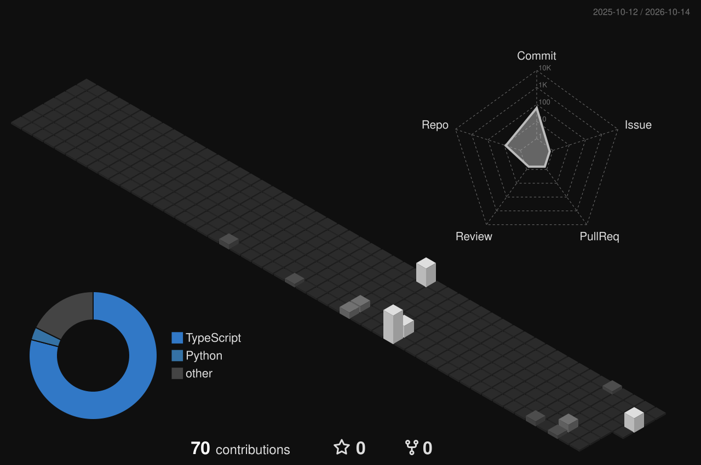

<!-- ░░ HEADER ░░ -->
<p align="center">
  
</p>

<p align="center">
  
</p>

<p align="center">
  <a href="https://github.com/pirathapanakshayan"></a>
  <a href="https://linkedin.com/in/YOUR_LINKEDIN"></a>
  <a href="mailto:YOUR_EMAIL"></a>
  
</p>


## ◼ about me

```yaml
name      : Pirathapan
role      : Student · Developer
learning  : Cybersecurity, Linux, C
building  : things that live in the terminal
motto     : "less noise, more signal."
```


## ◼ stack

<p align="center">
  
</p>


## ◼ stats

<p align="center">
  
  
</p>

<p align="center">
  
</p>


## ◼ contributions in 3D

<p align="center">
  
</p>

<p align="center">
  
</p>


<p align="center">
  <sub>// made in monochrome · <b>pirathapanakshayan</b></sub>
</p>
