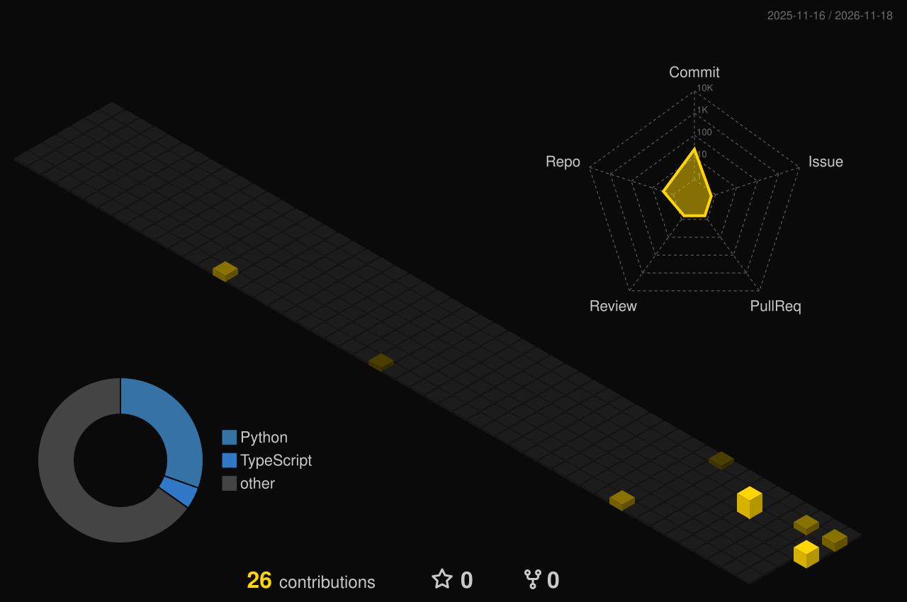

<!-- ═══════════════ HEADER ═══════════════ -->

  

  

  
  
  
  

<!-- ═══════════════ 01 ABOUT ═══════════════ -->

<!-- ═══════════════ 02 STACK ═══════════════ -->

<!-- ═══════════════ 03 STATS ═══════════════ -->

  
  

  

<!-- ═══════════════ 04 3D ═══════════════ -->

  

  

<!-- ═══════════════ FOOTER ═══════════════ -->

